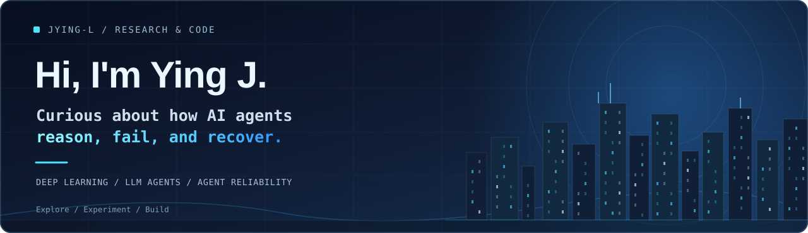

<div align="center">



<br/>

<a href="https://github.com/JYing-L">
  
</a>

<br/>

<sub>AI algorithms · Agent research · Systems that work beyond a demo</sub>

<br/><br/>

<a href="#selected-projects">Projects</a> &nbsp;·&nbsp;
<a href="#research-interests">Research</a> &nbsp;·&nbsp;
<a href="#technical-toolkit">Toolbox</a> &nbsp;·&nbsp;
<a href="#now">Now</a>

</div>

---

### 01 / About

I'm a graduate student interested in **AI algorithms** and **LLM-based agents**. My current research exploration focuses on understanding **why agents fail**, how to attribute failures to the right causes, and how agent systems can become more reliable.

I enjoy working across the research–engineering boundary: studying methods, running experiments, and building prototypes in Python and PyTorch.

```python
research_focus = {
    "core": ["LLM Agents", "Multi-Agent Systems"],
    "questions": ["Agent Reliability", "Failure Attribution"],
    "approach": ["Deep Learning", "Experimental Evaluation"],
}
```

### 02 / Selected Projects

<table>
<tr>
<td width="50%" valign="top">

**QAM-Fusion** <code>In development</code>

Quality-aware multimodal fusion research and implementation for sentiment analysis, with an emphasis on quality-aware gating and controlled comparisons.

<sub>`Python` · `PyTorch` · `Fusion`</sub>

<a href="https://github.com/JYing-L/QAM-Fusion">Repository ↗</a> <sub>(currently private; accessible only to authorized users)</sub>

</td>
<td width="50%" valign="top">

**agent-study** <code>Public</code>

My notes and hands-on practice while learning how to build LLM agent workflows, including an early travel-assistant demo.

<sub>`Python` · `LLM Agents` · `Practice`</sub>

<a href="https://github.com/JYing-L/agent-study">Explore repository ↗</a>

</td>
</tr>
<tr>
<td width="50%" valign="top">

**EMAA** <code>Exploratory</code>

A repository for exploring ideas around memory-augmented, empathy-oriented agents. It is an early-stage idea rather than a completed research result.

<sub>`Agents` · `Memory` · `Exploration`</sub>

<a href="https://github.com/JYing-L/Empathetic-Memory-Augmented-Agent-EMAA-">Explore repository ↗</a>

</td>
<td width="50%" valign="top">

**What I'm exploring next**

How can we diagnose an agent's failed execution from its trace, identify the responsible step, and design evaluations that distinguish symptoms from root causes?

<sub>`Failure Analysis` · `Traces` · `Evaluation`</sub>

<sub>Research direction — not a published result.</sub>

</td>
</tr>
</table>

### 03 / Research Interests

| Area | Questions I'm interested in |
| :--- | :--- |
| **LLM Agents** | Planning, tool use, and decision-making across long tasks |
| **Multi-Agent Systems** | Coordination, delegation, and interactions among agents |
| **Agent Reliability** | Error propagation, recoverability, and robust execution |
| **Failure Attribution** | Tracing failures to decisions, tools, or earlier execution steps |

### 04 / Technical Toolkit

<div align="left">
  
  
  
  
  
  
</div>

### 05 / Now

```text
> Exploring agent failure attribution and evaluation
> Studying LLM and multi-agent workflows
> Developing and organizing QAM-Fusion experiments
> Documenting what works — and what doesn't
```

---

<div align="center">

<sub>Good research asks better questions. Good engineering tests the answers.</sub>

<br/><br/>

<a href="https://github.com/JYing-L">GitHub</a> &nbsp;·&nbsp;
<a href="https://github.com/JYing-L?tab=repositories">Repositories</a>

</div>
