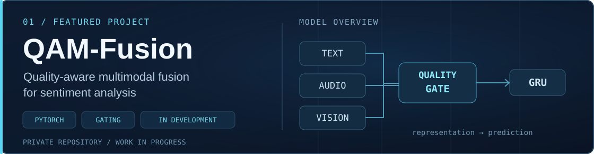
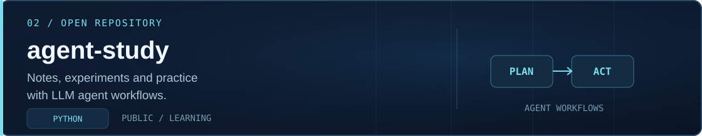
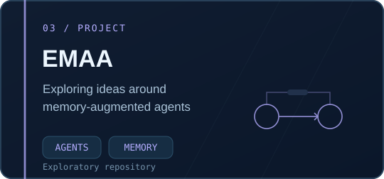
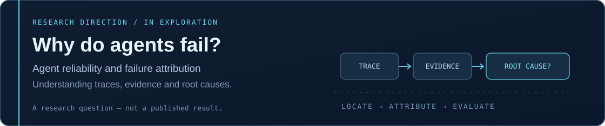

 

 

Graduate student · AI algorithms · LLM agent research

  

<a href="#about">About</a> &nbsp; · &nbsp;
<a href="#projects">Projects</a> &nbsp; · &nbsp;
<a href="#research">Research</a> &nbsp; · &nbsp;
<a href="#stack">Stack</a>

 

### <code>01 / ABOUT</code>

I am a graduate student exploring **AI algorithms** and **LLM-based agent systems**. I am particularly interested in **agent reliability and failure attribution**: understanding how failures occur, how to identify their causes, and how to evaluate proposed solutions.

I like the full process, from reading research and designing experiments to implementing and testing working systems.

 

### <code>02 / SELECTED PROJECTS</code>

**QAM-Fusion** · Quality-aware gating and fusion for sentiment analysis · **In development** · [Repository (private)](https://github.com/JYing-L/QAM-Fusion)

  

**agent-study** · Learning notes and practical agent examples · [View repository](https://github.com/JYing-L/agent-study)

  

**EMAA** · An exploratory repository, not a completed research result · [View repository](https://github.com/JYing-L/Empathetic-Memory-Augmented-Agent-EMAA-)

 

### <code>03 / RESEARCH</code>

 

  <code>LLM Agents</code> &nbsp;·&nbsp; <code>Multi-Agent Systems</code> &nbsp;·&nbsp; <code>Agent Reliability</code> &nbsp;·&nbsp; <code>Failure Attribution</code>

Current research interests and questions, not publication claims.

  

### <code>04 / TOOLKIT</code>

 

---

<i>Explore ideas. Build systems. Learn from failures.</i>

  

<a href="https://github.com/JYing-L">Profile</a> &nbsp; · &nbsp;
<a href="https://github.com/JYing-L?tab=repositories">Repositories</a>

